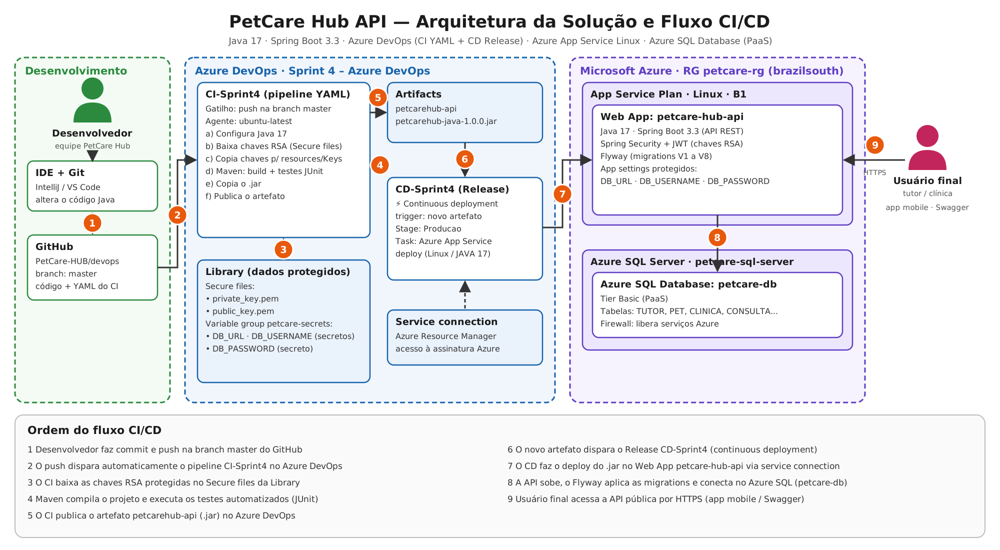

# PetCare Hub — DevOps Tools & Cloud Computing · Sprint 4

API Java do **PetCare Hub** publicada no **Azure App Service (Linux)** com banco **Azure SQL Database (PaaS)**, entregue automaticamente por pipelines de **CI/CD no Azure DevOps**.

---

## 👥 Integrantes da Equipe

| Nome Completo | RM | Turma | GitHub | LinkedIn |
| :--- | :---: | :---: | :--- | :--- |
| **Alexander Dennis Isidro Mamani** | 565554 | 2TDSPG | [alex-isidro](https://github.com/alex-isidro) | [LinkedIn](https://www.linkedin.com/in/alexander-dennis-a3b48824b/) |
| **Kelson Zhang** | 563748 | 2TDSPG | [KelsonZh0](https://github.com/KelsonZh0) | [LinkedIn](https://www.linkedin.com/in/kelson-zhang-211456323/) |

---

## 📖 1. Descrição da Solução

O **PetCare Hub** é uma plataforma de **monitoramento preventivo da saúde e bem-estar animal**, que conecta tutores de pets e clínicas veterinárias em um acompanhamento digital contínuo.

A solução é composta por:

1. **Telemetria IoT multissensor:** dados de coleiras inteligentes (atividade física e bateria), comedouros automatizados (consumo de ração e nível do dispenser) e sensores de ambiente (temperatura, umidade e qualidade do ar).
2. **Score de Saúde:** índice de 0 a 100 com classificação `VERDE`, `AMARELO` ou `VERMELHO`.
3. **Alertas clínicos:** notificação automática de anomalias para intervenção precoce.
4. **Histórico e protocolos preventivos:** vacinas, vermífugos, exames, check-ups e consultas veterinárias.

### 💡 Benefícios para o negócio

- **Detecção precoce de problemas:** identifica alterações na alimentação, sedentarismo súbito ou estresse térmico antes que virem quadros graves.
- **Fidelização entre clínicas e tutores:** canal digital direto, que estimula retornos e a adesão ao calendário preventivo.
- **Entrega contínua e confiável:** toda alteração na branch `master` é compilada, testada e publicada automaticamente, sem passos manuais.

---

## 🧰 2. Stack de Tecnologias

| Camada | Tecnologia |
| :--- | :--- |
| Linguagem / Framework | Java 17 · Spring Boot 3.3.5 |
| Segurança | Spring Security · OAuth2 Resource Server · JWT assinado com chaves RSA |
| Persistência | Spring Data JPA · Hibernate · Flyway (migrations V1 a V8) |
| Documentação da API | SpringDoc OpenAPI (Swagger UI) |
| Testes | JUnit 5 · Spring Boot Test |
| Build | Maven (Maven Wrapper) |
| Banco de dados | **Azure SQL Database** (PaaS · tier Basic) |
| Hospedagem | **Azure App Service** · Linux · Plano B1 · Java 17 |
| Repositório | GitHub — `PetCare-HUB/devops` |
| CI | Azure DevOps Pipelines — **CI-Sprint4** (YAML) |
| CD | Azure DevOps Releases — **CD-Sprint4** (Release clássico) |
| Infraestrutura | Azure CLI (scripts na pasta `script/`) |

---

## 🏗️ 3. Arquitetura da Solução e Fluxo CI/CD



### Ordem do fluxo

1. O desenvolvedor faz **commit e push na branch `master`** do GitHub.
2. O push **dispara automaticamente** o pipeline **CI-Sprint4** no Azure DevOps.
3. O CI baixa as **chaves RSA** guardadas no **Secure files** da Library.
4. O Maven **compila** o projeto e **executa os testes automatizados**.
5. O CI **publica o artefato** `petcarehub-api` (arquivo `.jar`) no Azure DevOps.
6. O novo artefato **dispara o Release CD-Sprint4** (continuous deployment trigger).
7. O CD faz o **deploy do `.jar` no Web App `petcare-hub-api`** usando a service connection.
8. A API sobe, o **Flyway aplica as migrations** e a aplicação conecta no **Azure SQL (`petcare-db`)**.
9. O usuário final acessa a API pública por **HTTPS** (app mobile ou Swagger).

---

## 🔁 4. Pipelines de CI/CD (Azure DevOps)

### CI — `CI-Sprint4` · arquivo [`azure-pipelines.yml`](azure-pipelines.yml)

| Etapa | O que faz |
| :--- | :--- |
| Gatilho | Qualquer alteração na branch `master` |
| Configurar Java 17 | Prepara o JDK 17 no agente `ubuntu-latest` |
| Baixar chaves RSA | `DownloadSecureFile` busca `private_key.pem` e `public_key.pem` na Library |
| Copiar chaves | Coloca as chaves em `src/main/resources/Keys` para entrarem no `.jar` |
| Build e testes | `./mvnw -B clean verify` — compila e executa os testes |
| Preparar artefato | Copia o `.jar` gerado em `backend/target` |
| Publicar artefato | `PublishPipelineArtifact` → artefato `petcarehub-api` |

### CD — `CD-Sprint4` · Release clássico

| Item | Configuração |
| :--- | :--- |
| Artefato de entrada | `_CI-Sprint4` → `petcarehub-api` (versão Latest) |
| Gatilho | ⚡ Continuous deployment trigger — dispara a cada novo build da `master` |
| Stage | `Producao` |
| Tarefa | Azure App Service deploy · Web App on Linux · `petcare-hub-api` |
| Pacote | `$(System.DefaultWorkingDirectory)/**/*.jar` |

### 🔒 Dados sensíveis protegidos

Nenhuma senha, usuário ou chave fica no código-fonte:

- **Chaves RSA do JWT:** Azure DevOps → Library → **Secure files**. A pasta `Keys/` está no `.gitignore`.
- **Credenciais do banco no pipeline:** Library → Variable group **`petcare-secrets`** (`DB_URL`, `DB_USERNAME` e `DB_PASSWORD` marcados como secretos).
- **Credenciais do banco no Web App:** App settings do App Service (`DB_URL`, `DB_USERNAME`, `DB_PASSWORD`).
- **No código**, a conexão usa apenas variáveis de ambiente:
  ```properties
  spring.datasource.url=${DB_URL}
  spring.datasource.username=${DB_USERNAME}
  spring.datasource.password=${DB_PASSWORD}
  ```

---

## ☁️ 5. Infraestrutura na Azure (via Azure CLI)

| Recurso | Nome |
| :--- | :--- |
| Resource Group | `petcare-rg` (brazilsouth) |
| Azure SQL Server | `petcare-sql-server` |
| Azure SQL Database | `petcare-db` (Basic) |
| App Service Plan | `petcare-plan` (Linux · B1) |
| Web App | `petcare-hub-api` (Java 17) |

### Scripts (`script/`)

| Script | Função |
| :--- | :--- |
| [`00-GERAR-CHAVES.sh`](script/00-GERAR-CHAVES.sh) | Gera o par de chaves RSA (formato PKCS#8) usado pelo JWT |
| [`01-INFRAESTRUTURA.sh`](script/01-INFRAESTRUTURA.sh) | Cria Resource Group, Azure SQL Server, Azure SQL Database, firewall, App Service Plan Linux e Web App Java 17, e configura a conexão da API com o banco |
| [`02-DEPLOY-MANUAL.sh`](script/02-DEPLOY-MANUAL.sh) | Deploy manual do `.jar`, usado apenas para validação. Em produção, quem faz o deploy é o CD |
| [`04-DELETAR-INFRAESTRUTURA.sh`](script/04-DELETAR-INFRAESTRUTURA.sh) | Remove o Resource Group e todos os recursos |

### Banco de dados

- **Serviço:** Azure SQL Database (PaaS).
- **Estrutura:** criada automaticamente pelo **Flyway** na primeira inicialização da API (`backend/src/main/resources/db/migration`).
- **DDL completo:** [`database/script_bd.sql`](database/script_bd.sql).
- **Tabelas core:** `TUTOR`, `CLINICA`, `PET`, `CONSULTA`, `PROTOCOLO_PREVENTIVO`, `EVENTO_PREVENTIVO`, `DISPOSITIVO_IOT`, `LEITURA_COLEIRA`, `LEITURA_COMEDOURO`, `LEITURA_AMBIENTE`, `ALERTA_SAUDE`, `SCORE_SAUDE`.

---

## 🚀 6. Guia Passo a Passo (How-To)

Pré-requisitos: Azure CLI, Git Bash (ou Linux/macOS), Java 17 e OpenSSL.

### 6.1 Criar a infraestrutura

```bash
# 1. Clonar o repositório
git clone https://github.com/PetCare-HUB/devops.git
cd devops

# 2. Login na Azure
az login

# 3. Gerar as chaves RSA
bash script/00-GERAR-CHAVES.sh

# 4. Criar a infraestrutura (a senha não fica salva no código)
export SQL_PASSWORD='SuaSenhaForte@2026'
bash script/01-INFRAESTRUTURA.sh
```

### 6.2 Configurar o Azure DevOps

1. **Projeto:** `Sprint 4 – Azure DevOps` · Private · Git · Scrum.
2. **Library → Secure files:** enviar `private_key.pem` e `public_key.pem` (gerados no passo 3).
3. **Library → Variable groups:** criar `petcare-secrets` com `DB_URL`, `DB_USERNAME` e `DB_PASSWORD` (secretos).
4. **Project settings → Service connections:** criar uma conexão *Azure Resource Manager* com a assinatura.
5. **Pipelines → New pipeline → GitHub** → `PetCare-HUB/devops` → *Existing YAML file* → `/azure-pipelines.yml` → nome **CI-Sprint4**.
6. **Releases → New pipeline** → template *Azure App Service deployment*:
   - Artefato: `CI-Sprint4`, com o *Continuous deployment trigger* habilitado para a `master`.
   - Stage `Producao`: Web App on Linux → `petcare-hub-api` → pacote `$(System.DefaultWorkingDirectory)/**/*.jar`.
   - Nome: **CD-Sprint4**.

### 6.3 Executar o CI/CD

Qualquer push na `master` dispara o fluxo completo:

```bash
git add .
git commit -m "feat: descrição da alteração"
git push origin master
```

O CI-Sprint4 roda, publica o artefato e o CD-Sprint4 faz o deploy automaticamente.

### 6.4 Acompanhar os logs da API (opcional)

```bash
az webapp log tail --resource-group petcare-rg --name petcare-hub-api
```

### 6.5 Excluir os recursos (somente após a avaliação)

```bash
bash script/04-DELETAR-INFRAESTRUTURA.sh
```

---

## 🔄 7. Teste do CRUD (tabelas `CLINICA`, `TUTOR` e `PET`)

**Base da API:** `https://petcare-hub-api.azurewebsites.net`

O pet depende de uma clínica e de um tutor, então crie nesta ordem.

### Inclusão (CREATE)

**POST** `/clinicas`

```json
{
  "nome": "Clínica Vet Paulista",
  "email": "contato@vetpaulista.com.br",
  "senha": "Senha@12345",
  "cnpj": "12.345.678/0001-90",
  "endereco": "Av. Paulista, 1000 - São Paulo",
  "telefone": "11999990000"
}
```

**POST** `/tutor`

```json
{
  "nome": "Carlos Eduardo Silva",
  "email": "carlos.silva@email.com",
  "telefone": "11987654321",
  "cpf": "12345678909"
}
```

**POST** `/pets` (use os IDs retornados acima)

```json
{
  "nome": "Thor",
  "especie": "CAO",
  "raca": "Golden Retriever",
  "dataNascimento": "2021-05-10",
  "sexo": "M",
  "condicoesCronicas": "Displasia coxofemoral leve",
  "ativo": true,
  "tutorId": 1,
  "clinicaId": 1
}
```

### Consulta (READ)

- **GET** `/pets` e **GET** `/pets/{id}`
- **GET** `/tutor` e **GET** `/tutor/{id}`

### Alteração (UPDATE)

**PUT** `/pets/{id}` — mesmo JSON, alterando por exemplo:

```json
"condicoesCronicas": "Displasia coxofemoral sob controle e fisioterapia"
```

### Exclusão (DELETE)

**DELETE** `/pets/{id}`

### Validação no banco (Portal Azure → `petcare-db` → Query editor)

```sql
SELECT * FROM dbo.CLINICA;
SELECT * FROM dbo.TUTOR;
SELECT * FROM dbo.PET;

SELECT t.id_tutor, t.nome AS nome_tutor, p.id_pet, p.nome AS nome_pet, p.especie, p.condicoes_cronicas
FROM dbo.TUTOR t
INNER JOIN dbo.PET p ON t.id_tutor = p.id_tutor;
```

Execute os `SELECT` depois de cada operação para comprovar a inclusão, a alteração e a exclusão.

---

## 🌐 8. Endpoints e Documentação

- **Swagger UI:** https://petcare-hub-api.azurewebsites.net/swagger-ui.html
- **OpenAPI (JSON):** https://petcare-hub-api.azurewebsites.net/v3/api-docs

| Recurso | Endpoints principais |
| :--- | :--- |
| Autenticação | `POST /auth/login` · `POST /auth/ativar-conta` |
| Pets | `GET/POST /pets` · `GET/PUT/DELETE /pets/{id}` · `GET /pets/{id}/score-saude` · `GET /pets/{id}/timeline` |
| Tutores | `GET/POST /tutor` · `GET/PUT/DELETE /tutor/{id}` |
| Clínicas | `GET/POST /clinicas` · `GET/PUT/DELETE /clinicas/{id}` · `GET /clinicas/{id}/pets-em-risco` |
| Consultas | `GET/POST /consultas` · `GET/PUT/DELETE /consultas/{id}` |
| Leituras IoT | `POST /leituras/coleira` · `POST /leituras/comedouro` · `POST /leituras/ambiente` |
| Alertas | `GET/POST /alertas` · `PUT /alertas/{id}/resolver` · `DELETE /alertas/{id}` |

---

## 📁 9. Organização do Repositório

```
devops/
├── azure-pipelines.yml        # Pipeline de CI (CI-Sprint4)
├── README.md
├── docs/
│   └── arquitetura.png        # Diagrama de arquitetura + fluxo CI/CD
├── database/
│   └── script_bd.sql       # DDL completo do banco
├── script/                    # Scripts Azure CLI
│   ├── 00-GERAR-CHAVES.sh
│   ├── 01-INFRAESTRUTURA.sh
│   ├── 02-DEPLOY-MANUAL.sh
│   └── 04-DELETAR-INFRAESTRUTURA.sh
└── backend/                   # API Spring Boot (Java 17)
    ├── pom.xml
    ├── docs/                  # Diagrama de classes, documentação Java e coleção Insomnia
    └── src/
        ├── main/java/...      # Código da aplicação
        ├── main/resources/db/migration/   # Migrations Flyway
        └── test/java/...      # Testes automatizados
```
